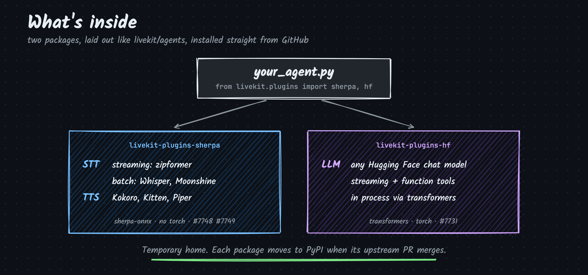

<p align="center">
  
</p>

<p align="center">
  <a href="#install">install</a> • <a href="#use">use</a> • <a href="https://github.com/mahimairaja/local-livekit">example agent</a> • <a href="https://mahimai.ca/blog/local-livekit-voice-agent-offline">blog</a> • <a href="https://github.com/livekit/agents">livekit/agents</a>
</p>

<p align="center">
  
  
  
  
</p>

## hello

STT, TTS and LLM plugins for [LiveKit Agents](https://github.com/livekit/agents), installable from GitHub ahead of their PyPI release. sherpa and hf are the code from open livekit/agents pull requests and run inside the agent process: no API keys, no network calls at inference time, no per-minute cost. modal runs on your own Modal account.

<p align="center">
  
</p>

## plugin tracker (3 plugins, 3 upstream PRs)

<table>
  <tr>
    <th>plugin</th>
    <th>component</th>
    <th>upstream PR</th>
    <th>PyPI</th>
    <th>source</th>
  </tr>
  <tr>
    <td><a href="livekit-plugins/livekit-plugins-sherpa"><b>livekit-plugins-sherpa</b></a><br><sub>Speech-to-text (streaming Zipformer; batch Whisper, Moonshine, SenseVoice, Parakeet) and text-to-speech (Kokoro, Kitten, Piper) on <a href="https://github.com/k2-fsa/sherpa-onnx">sherpa-onnx</a>. ONNX Runtime only.</sub></td>
    <td>STT, TTS</td>
    <td><a href="https://github.com/livekit/agents/pull/7748"></a><br><a href="https://github.com/livekit/agents/pull/7749"></a></td>
    <td><a href="https://pypi.org/project/livekit-plugins-sherpa/"></a></td>
    <td><a href="livekit-plugins/livekit-plugins-sherpa"></a></td>
  </tr>
  <tr>
    <td><a href="livekit-plugins/livekit-plugins-hf"><b>livekit-plugins-hf</b></a><br><sub>Any Hugging Face chat model, run in process with <code>transformers</code>. Streaming and function tools.</sub></td>
    <td>LLM</td>
    <td><a href="https://github.com/livekit/agents/pull/7731"></a></td>
    <td><a href="https://pypi.org/project/livekit-plugins-hf/"></a></td>
    <td><a href="livekit-plugins/livekit-plugins-hf"></a></td>
  </tr>
  <tr>
    <td><a href="livekit-plugins/livekit-plugins-modal"><b>livekit-plugins-modal</b></a><br><sub>Speech-to-text on your own <a href="https://modal.com">Modal</a> GPUs: Whisper large-v3-turbo. Provision once from the CLI, then the agent finds the deployment by name. The one plugin here that is not local.</sub></td>
    <td>STT</td>
    <td>none, lives here</td>
    <td>–</td>
    <td><a href="livekit-plugins/livekit-plugins-modal"></a></td>
  </tr>
</table>

The PR and PyPI badges are live. When an upstream PR turns **merged** and the PyPI badge shows a version, the plugin is an official LiveKit package: install it with `pip install <package>` and drop the GitHub install. Package and import names already match upstream (`from livekit.plugins import sherpa, hf`), so no code changes are needed. `livekit-plugins-sherpa` leaves this repo once both its STT and TTS PRs have merged.

## install

```bash
pip install "livekit-plugins-sherpa @ git+https://github.com/mahimairaja/livekit-plugins#subdirectory=livekit-plugins/livekit-plugins-sherpa"
pip install "livekit-plugins-hf @ git+https://github.com/mahimairaja/livekit-plugins#subdirectory=livekit-plugins/livekit-plugins-hf"
pip install "livekit-plugins-modal @ git+https://github.com/mahimairaja/livekit-plugins#subdirectory=livekit-plugins/livekit-plugins-modal"
```

With uv, use `uv add` with the same string. To pin a commit, append `@<commit>` to the repository URL.

Requires Python 3.12 to 3.14. Dependencies are pinned exactly, including `livekit-agents==1.8.6`.

## use

```python
from livekit.agents import AgentSession
from livekit.plugins import hf, sherpa, silero

session = AgentSession(
    stt=sherpa.STT(),  # streaming zipformer, English
    llm=hf.LLM(model="Qwen/Qwen2.5-1.5B-Instruct"),
    tts=sherpa.TTS(voice="af_heart"),  # Kokoro
    vad=silero.VAD.load(),  # pip install livekit-plugins-silero
)
```

Download the models once while online. The agent does not download anything at runtime:

```bash
python my_agent.py download-files
```

Configuration options, supported models and tool calling are documented in each plugin's README.

## example

[local-livekit](https://github.com/mahimairaja/local-livekit) combines these plugins into a single voice agent that runs fully offline. Write-up: [A LiveKit voice agent that runs offline](https://mahimai.ca/blog/local-livekit-voice-agent-offline).

## issues

Bugs that also apply to the upstream code are best reported on the corresponding livekit/agents PR. Issues specific to this packaging belong here.

## develop

```bash
uv sync
uv run pytest                       # unit tests, plus real-model tests (download once, skip offline)
uv run pre-commit run --all-files   # ruff, mypy --strict, uv lock --check
```

## license

Plugin packages are Apache-2.0, matching livekit/agents. The rest of the repo is MIT.
